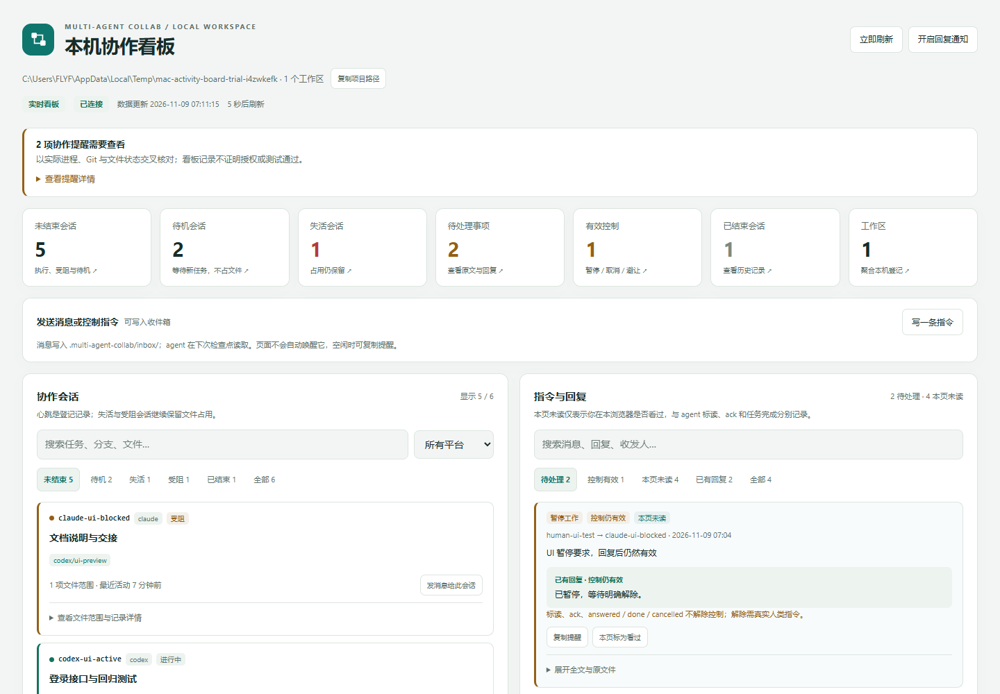

<h1>
  <picture>
    <source media="(prefers-color-scheme: dark)" srcset="site/assets/logo/logo.svg">
    
  </picture>
</h1>

[](https://www.python.org/)
[](#安装下载一次按项目复用)
[](#仓库结构与验证)
[](LICENSE)
[](CHANGELOG.md)

**本机 AI 编码协作套件。** 让同一项目里的 Codex、Claude Code、Cursor 等助手共享任务、文件占用、指令和交接记录，按项目分支策略开工，留下实际测试结果再收尾。

适合同一电脑上多客户端切换、多个会话接力，或在不同 Git worktree 中处理不重叠文件。
协作记录保存在本地；检查和登记由 agent 执行，消息在调用套件工具或阶段检查时送达，空闲会话需要人工提醒。

[在线介绍与安装配置](https://aiflyf.github.io/multi-agent-collab/) ·
[交互演示](https://aiflyf.github.io/multi-agent-collab/demo.html) ·
[操作手册](docs/WORKFLOW.md) · [平台接入](docs/PLATFORMS.md) · [更新记录](CHANGELOG.md)

**版本说明：** 当前版本为 1.8.0。默认安装源码取仓库 `main`；已经安装到项目中的套件需要执行更新命令，新提示词需要新开对话或明确重读后生效。
以下载副本的 `CHANGELOG.md`、命令 `--help` 和安装体检结果为准。

## 安装：下载一次，按项目复用

需要 **Python 3.8+、Git、一个已有的 Git 项目**，没有第三方 Python 依赖。
套件源码放在用户主目录，所有目标项目复用这一个安装器；**源码目录与目标项目必须分开，禁止在套件源码目录自安装**。

将下面的 `<目标项目绝对路径>` 换成你的项目路径，例如 Windows 的 `D:/code/my-app` 或 Linux 的 `/home/you/code/my-app`。
命令可用于 PowerShell 和 Bash。首次示例使用 Codex 与 Claude Code；按需替换 `--platforms`。

```bash
# 首次下载；目录已存在时核对来源和本地修改后复用
git clone https://github.com/AiFLYF/multi-agent-collab "$HOME/multi-agent-collab"

# 先预览，核对目标和文件清单，再安装、体检
python "$HOME/multi-agent-collab/install.py" install "<目标项目绝对路径>" --platforms codex,claude --dry-run
python "$HOME/multi-agent-collab/install.py" install "<目标项目绝对路径>" --platforms codex,claude
python "$HOME/multi-agent-collab/install.py" doctor "<目标项目绝对路径>"
```

首次默认 Git Flow，以 `develop` 为基线。项目以 `main` 为基线时，在两条安装命令中加 `--workflow github-flow`；
已有策略会沿用，安装器不创建或切换 Git 分支。自定义流程见 [分支策略](docs/WORKFLOW.md#按项目选择分支策略)。

终端交互安装可省略 `--platforms` 后多选；AI 或脚本执行时明确传入。`none` 只装通用规则，`all` 才全选。
只选 `codex`、`opencode` 或 `pi` 时共用根 `AGENTS.md`，不会生成其它平台目录或 `CLAUDE.md`。

### 装完验证三件事

1. 在目标项目的 `.multi-agent-collab/RULES.md` 第 6 节补齐项目实际测试、构建命令，核对 `POLICY.md` 与项目分支约定。
2. 检查 `doctor` 输出；在**目标项目根目录**执行下面两条只读命令。返回 1 先处理告警或未读事项，返回 2 先排查错误。
3. **新开所选客户端的对话**，要求它实际读取 `.multi-agent-collab/START_HERE.md`，报告当前分支、策略、占用与相关 inbox。
   验收方法见 [平台说明](docs/PLATFORMS.md#如何确认真的生效)；旧对话需主动重读变化部分。

```bash
git status --short --branch
python .multi-agent-collab/tools/agents_status.py --context --agent codex
```

<details>
<summary>把安装交给 AI：展开并复制提示词</summary>

在**目标项目的对话**中粘贴。AI 沿用已确认的平台与分支约定；使用 fork 时替换仓库地址。
[在线配置器](https://aiflyf.github.io/multi-agent-collab/#sec-6) 可按平台生成提示词，下载版本仍以上面的版本说明为准。

<!-- BEGIN INSTALL_PROMPT -->
```text
帮我把 multi-agent-collab 安装到当前项目，并验证所选平台的新对话入口。
套件仓库：https://github.com/AiFLYF/multi-agent-collab

1. 检查 Python 3.8+ 和 Git，确认当前项目的 Git 根目录并记下绝对路径 TARGET。缺依赖时说明，不自行安装软件或 git init。
2. 优先根据当前对话确认正在使用的平台并告诉我；无法确认时先问我使用哪些平台（可多选）：codex、claude、opencode、pi、trae、workbuddy、cursor、copilot、windsurf、gemini、qwen、cline、roo、continue、kiro。使用对应的 --platforms 名称；不要根据电脑里装过哪些软件就全部安装。
   读取项目现有分支约定与 .multi-agent-collab/policy.json；已有策略沿用，首次安装按已确认流程选择 git-flow、github-flow 或 custom。只有 main 的项目可使用 github-flow；无法确认时只询问分支流程，不擅自建立 develop 或改变远端结构。
3. 套件默认放在用户主目录的 multi-agent-collab：Windows 为 $HOME\multi-agent-collab，macOS/Linux 为 ~/multi-agent-collab。这里是可供多个项目复用的源码目录，不要 clone 到 TARGET 内。
   目录不存在时执行 git clone https://github.com/AiFLYF/multi-agent-collab "<用户主目录>/multi-agent-collab"。已存在时核对 origin 和 install.py 后复用；来源不符或有本地修改时保留现场并说明，不覆盖、不删除、不重置。只有确认工作区干净且配置了上游后，才用 git pull --ff-only 更新。
4. 使用绝对路径运行 python "<套件目录>/install.py" install "<TARGET>" --platforms <已选名称> --dry-run；首次安装附加已确认的 --workflow 参数，自定义流程还要 --base-branch 和 --task-prefixes。核对文件清单与分支策略后执行同一条命令去掉 --dry-run；不要默认 all。只选原生平台时不生成其它平台配置。
5. 新安装把套件规则、工具、记录放入 .multi-agent-collab/，默认在项目 .gitignore 的标记区忽略该目录；平台入口按精确路径写入 .git/info/exclude。已有 AGENTS.md 等共享入口保留原文，只维护小段标记。已跟踪入口的差异正常显示，不取消跟踪，不隐藏索引改动。来源不明的独立目录、损坏标记或被修改的套件文件先报告并保留现场。
6. 结合项目真实配置填写 .multi-agent-collab/RULES.md 第 6 节缺少的测试/构建命令，项目既有测试要求和已确认策略继续有效。保留已有规则、会话、日志和备份。旧版安装沿用 .agents/ 路径，不自动搬迁；新增平台使用 sync。
7. 执行 python "<套件目录>/install.py" doctor "<TARGET>"，并核对 git status --short；可用 clients "<TARGET>" --versions 检查 CLI 可用性，不启动模型。汇报套件复用路径、已选平台、项目分支策略、生成文件和体检结果；解释 WARN，版本查询不代表新对话已加载规则。
8. 告诉我新开对话验证：让 agent 执行 .multi-agent-collab/START_HERE.md 的开工、执行中与最终答复前清单，报告实际分支、看板和 inbox。普通业务工具带自己的平台和会话 ID 记录活动；完成默认 finish --standby 释放范围等待新任务，未完成 handoff 保留占用，并核验命令成功后答复。之后增加平台用 sync "<TARGET>" --platforms <新增名称>；旧核心先完整 update 再 sync，能力不足不写新版入口，无需重复 clone；旧对话需主动重读变化部分。

执行安装范围内可恢复的修复即可；遇到需要改变现有项目规则或 Git 跟踪状态的冲突，再说明具体情况让我决定。
```
<!-- END INSTALL_PROMPT -->

</details>

## 日常协作：开工、进度、交接与完成

下面的项目内命令都在**目标项目根目录**运行，`<自己的ID>` 使用 `start` 实际返回的 ID。
只读咨询不登记写会话；继续同一任务沿用分支和 ID。

| 你要做什么 | 使用哪一步 |
|---|---|
| 开始写任务 | 读启动入口、检查动态状态与策略，协调后建任务分支，再 `start` 登记真实文件范围 |
| 继续自己的 active 任务 | 正常工具调用携带自己的平台/ID，自动记录活动；`heartbeat` 更新进度与范围 |
| 扩大修改范围 | 先用 `heartbeat --files` 提交完整新列表，成功后再写 |
| 暂时不能继续 | `handoff` 写下一步、阻塞和未提交位置，保留占用；继续时先 `resume` |
| 任务完成，继续等待新命令 | 最终答复前核验实际测试、回复原事项，运行 `finish --standby` 保存结果并释放占用 |
| 待机接到新任务 | 确认新任务分支，用 `activate --task ... --files ...` 重新登记完整范围 |
| 明确结束对话 | `finish` 置 done，结束的 ID 不能再次用于新任务 |

```bash
python .multi-agent-collab/tools/agents_session.py start --agent codex --task "完善登录校验" --files src/login.py tests/test_login.py --json
python .multi-agent-collab/tools/agents_session.py heartbeat <自己的ID> --agent codex --note "正在验证登录校验"
python .multi-agent-collab/tools/agents_session.py finish <自己的ID> --agent codex --summary "实际完成内容与交付位置" --tests "实际运行的测试命令和结果" --standby

# 新任务在已确认的任务分支重新登记，不沿用旧任务的文件占用
python .multi-agent-collab/tools/agents_session.py activate <自己的ID> --agent codex --task "完善注册校验" --files src/register.py tests/test_register.py --json
```

状态、消息和安装等业务工具明确携带 `--agent codex --session <自己的ID>` 后，核验自身记录并自动节流更新最近活动。
旁观查询和网页自动刷新不会给别人续活；纯审计加 `--no-activity`，安装预览与更新 `--check` 保持零写。
任意测试或命令可包装执行，保留原输出与退出码，执行期间持续记录活动：

```bash
python .multi-agent-collab/tools/agents_session.py run <自己的ID> --agent codex -- python -m unittest discover -s tests
```

活动时间表示最近使用工具，任务状态仍由 `activate / handoff / finish` 明确转换。
收尾前须等本任务全部子代理、测试和包装命令真正结束并收齐结果；仍有运行中或无法核验的命令时，工具拒绝释放文件范围。
写前还要按项目规则核对远端、open PR、进程、reflog 与文件修改时间。
同一物理工作区由一个主会话协调写任务；同任务子代理分配不重叠文件，Git 操作集中执行。
失活和 blocked 都保留占用，同文件不同函数也算冲突。详细步骤见 [操作手册](docs/WORKFLOW.md)。

### 收到消息或人类指令

业务工具会顺带提示相关未读 inbox 和新回复；出现提示再读取：

```bash
python .multi-agent-collab/tools/agents_messages.py read --agent codex --session <自己的ID>
python .multi-agent-collab/tools/agents_messages.py send --to any --body "请确认 middleware 顺序" --agent codex --session <自己的ID>
python .multi-agent-collab/tools/agents_messages.py reply "<原文件绝对路径或唯一文件名>" --body "收到，正在核对" --agent codex --session <自己的ID>
python .multi-agent-collab/tools/agents_messages.py reply "<原文件绝对路径或唯一文件名>" --body "已完成，实际验证结果：..." --status answered --agent codex --session <自己的ID>
python .multi-agent-collab/tools/agents_messages.py archive            # 只预览，不移动任何文件
python .multi-agent-collab/tools/agents_messages.py archive --apply --agent codex --session <自己的ID>
```

`send` / `reply` 以当前已登记会话作为发送者；agent 不能发送暂停、取消或避让控制，这些仍由人类在看板发出。
`reply` 默认保持 `open`；处理完成并写入实际结果后用 `--status answered`。可回复发给 `any`、当前平台或当前会话的消息。
需要保护读取后的原要求时，加 `--request-version <read返回的request_version>`；要求变化则拒绝旧回复。控制的完成回复不解除暂停等状态。
`archive` 只处理当前工作区已关闭、且创建/回复/修改均超过保留期（默认 30 天）的普通消息，
保留未答事项、控制、未读回复和未结束会话引用。默认预览零写，带身份的 `--apply` 才归档；
每批默认 100 条，可用 `--limit` 调整，明细按 `--max-chars` 裁剪并保留总数，失败尝试回滚本批。同名目标拒绝覆盖。

`list/read` 默认不修改消息与阅读回执，明确身份的调用会记录自己的活动；纯只读审计加 `--no-activity`。
确认完整阅读后可加 `--mark-read` 保存本会话回执；它不改变事项状态或表示已获授权。
在原 inbox 追加计划和结果，执行中保留 `open`，完成后置 `answered`。
暂停、取消、避让立即停止对应写入，不能靠标读或 `--ack-inbox` 解除。
[消息读取与状态规则](docs/README.md#按需读取消息) · [暂停与恢复](docs/WORKFLOW.md#中断恢复交接与收尾)

## 网页看板

在**目标项目根目录**启动：

```bash
python .multi-agent-collab/tools/agents_status.py --web
```



上图为浏览器实拍，数据来自隔离示例项目。
看板每 5 秒刷新，支持会话与收件箱搜索、状态筛选，可查看任务、最近活动、待机、文件占用、inbox 与 worktree 告警，也可向指定会话或 `any` 发指令。
看板会提示开始任务后出现的“未登记改动”；已存在的脏文件随后再次变化也会提示。它提示范围差异，不能证明是哪一个 agent 修改；缺失/损坏基线不推测，也不释放占用。
“本页看过”只记录当前浏览器的查看状态，不代替 agent 的阅读回执或事项完成。
agent 在阶段间隙读取并回复；空闲会话用「复制提醒」粘贴到对应对话中唤起。
[交互演示](https://aiflyf.github.io/multi-agent-collab/demo.html) 使用示例数据，真实项目使用本地看板。

`--no-open` 适合自行打开浏览器，`--html` 导出单文件快照，`--brief` 只看一行状态。
局域网只读分享用 `--web --bind 0.0.0.0 --no-directives`；更多输出与访问配置见 [看板说明](docs/README.md#查看全景)。

## 平台选择与同步

<!-- BEGIN PLATFORM_TABLE -->
| `--platforms` 名称 | 平台 | 本套件安装的入口 |
|---|---|---|
| `codex` | Codex | 共用 `AGENTS.md`，无额外文件 |
| `claude` | Claude Code | `CLAUDE.md`<br>`.claude/commands/git-flow.md` |
| `opencode` | OpenCode | 共用 `AGENTS.md`，无额外文件 |
| `pi` | Pi | 共用 `AGENTS.md`，无额外文件 |
| `trae` | Trae | `.trae/rules/git-flow-agent.md` |
| `workbuddy` | WorkBuddy | `.workbuddy-ai/git-flow-agent.md` |
| `cursor` | Cursor | `.cursor/rules/multi-agent-collab.mdc` |
| `copilot` | GitHub Copilot | `.github/copilot-instructions.md` |
| `windsurf` | Windsurf | `.windsurf/rules/multi-agent-collab.md` |
| `gemini` | Gemini CLI | `GEMINI.md` |
| `qwen` | Qwen Code | `.qwen/QWEN.local.md` |
| `cline` | Cline | `.clinerules/multi-agent-collab.md` |
| `roo` | Roo Code | `.roo/rules/00-multi-agent-collab.md` |
| `continue` | Continue | `.continue/rules/multi-agent-collab.md` |
| `kiro` | Kiro | `.kiro/steering/multi-agent-collab.md` |
<!-- END PLATFORM_TABLE -->

加载方式、客户端开关与新对话验收见 [平台说明](docs/PLATFORMS.md)。
平台入口指向同一份共享规则；选择写入 `install.json`，后续沿用。
`install` / `sync` 的 `--platforms` 均为追加，不删除已有入口，`none` 也不等于卸载。
旧版本核心先完整更新，再用新版 `sync` 添加平台。同步不会升级核心；缺少待机、活动或消息工具时会拒绝，避免新提示词调用旧工具不支持的参数。

```bash
# 后来开始用 Cursor：追加入口，保留已选平台
python "$HOME/multi-agent-collab/install.py" sync "<目标项目绝对路径>" --platforms cursor

# 只刷新已选入口；核心工具升级见下一节
python "$HOME/multi-agent-collab/install.py" sync "<目标项目绝对路径>"
```

## 更新已安装项目

| 当前需求 | 使用命令 | 更新范围 |
|---|---|---|
| 首次安装 | `install <项目> --platforms <名称>` | 规则、工具、记录模板与所选入口 |
| 新增平台或刷新入口 | `sync <项目> [--platforms <新增名称>]` | 已选入口与忽略配置，保留总章及运行记录 |
| 升级核心规则和工具 | `update <项目>` 或项目内 `agents_update.py` | 沿用平台、策略，迁移定制区，保留会话、日志、inbox 和备份 |

先准备本地新版套件源。项目内更新入口从 `install.json` 读取源码位置，**不会下载源码或切换源码分支**。
在目标项目根目录运行：

```bash
python .multi-agent-collab/tools/agents_update.py --check --json
python .multi-agent-collab/tools/agents_update.py --dry-run
python .multi-agent-collab/tools/agents_update.py
```

`--check` 返回 0 已最新、1 有可更新内容、2 错误；按实际文件内容比较，同版本也能发现变化。
预览默认列变更，加 `--diff` 查看详细差异；源码位置改变时加 `--source "<本地套件目录>"`。
旧安装没有更新入口时，从新版源执行 `python "<套件目录>/install.py" update "<目标项目绝对路径>"`。
较低版本默认拒绝；区外自定义或文件变化会保留现场并报告。更新后重启长驻看板，让旧对话重读变化规则。

## 安装目录、已有文件与旧布局

新安装将协作规则、工具和本机记录集中在 `.multi-agent-collab/`：

```text
你的项目/
├── AGENTS.md                         # 项目原文 + 套件入口标记
├── .multi-agent-collab/
│   ├── RULES.md / START_HERE.md        # 总章 / 新对话入口
│   ├── install.json / policy.json     # 安装选择、源码位置 / 分支策略
│   ├── POLICY.md / WORKFLOW.md         # 策略说明 / 操作手册
│   ├── sessions/ / worklog/ / inbox/   # 任务、日志、问题与指令
│   ├── tools/                         # 看板、会话、消息与更新命令
│   └── backups/                       # 升级前的原始字节备份
└── 所选平台入口                        # 见平台表
```

项目 `.gitignore` 只追加套件标记区；新建平台入口按精确路径写入本机 `.git/info/exclude`。
项目原有 `AGENTS.md`、`CLAUDE.md` 等说明保留原文，只维护入口标记。
**已跟踪文件保持跟踪，真实差异正常显示**；专用入口归属不明、标记损坏或用户修改会先报告，保留现场。
记录不随 Git clone 同步，重要节点自行备份到仓库外。

| 目录类型 | 规则与本机记录 | 运行工具 |
|---|---|---|
| 新版目标项目 | `.multi-agent-collab/` | `.multi-agent-collab/tools/` |
| 已记录的旧版安装 | 保留 `.agents/` | 保留项目根 `tools/` |
| 套件源码开发 | 产品模板在 `docs/`，本机记录在 `.agents/` | 源码 `tools/`，禁止自安装 |

旧版不会自动搬迁未结束记录。以实际 `install.json` 和根入口中的路径为准，先核对 `--dry-run` 差异再更新；
不要为了套用新路径移动旧目录。共享库供业务工具调用，`agents_processes.py` 由 run 内部启动；统一使用上述业务入口。

## 命令速查与故障处理

安装器命令使用 `python "<套件目录>/install.py" <命令> "<目标项目绝对路径>"`；
先用相应 `--help` 查看下载版本支持的参数。

| 命令 | 用途 |
|---|---|
| `platforms [--json]` | 平台与入口清单，无需目标路径 |
| `doctor <项目>` | 文件、入口、版本、忽略与看板体检 |
| `clients <项目> --versions [--json]` | 查询 CLI 可用性和版本，新对话加载需单独验证 |
| `uninstall <项目> --dry-run` | 预览卸载文件和入口变化 |
| `uninstall <项目>` | 移除已确认归属的入口块，保留私有记录和忽略 |
| `uninstall <项目> --purge-files` | 同时清理未修改工具，保留定制、记录、策略与备份 |

遇到问题先按 [故障手册](docs/TROUBLESHOOTING.md) 索引定位，再运行体检；实际项目在 `.multi-agent-collab/TROUBLESHOOTING.md` 追加自己的故障记录。
失联任务先 [接管检查与计划](docs/TAKEOVER.md)，等待至少 5 分钟、用户确认具体计划且快照一致后才执行；保留原提交和未提交文件。
[会话示例](docs/examples/session-example.md) · [交接示例](docs/examples/inbox-example.md) · [项目故障示例](docs/examples/project-specific-troubleshooting.md)

## 仓库结构与验证

以下命令仅在**套件源码目录**运行：

```text
multi-agent-collab/
├── install.py                  # 安装、更新、同步、体检与卸载
├── docs/                       # 发布规则、操作手册与验证报告
├── platforms/ / templates/     # 平台入口与记录模板
├── tools/                      # 看板、会话、消息、更新及共享库
├── scripts/                    # 流程演练、文档同步与上下文测量
├── site/                       # 静态介绍页、配置器与示例演示
├── tests/selftest.py            # 44 个测试用例（16 单元 + 28 安装器 E2E）
└── .github/workflows/           # 多系统、多 Python 版本 CI 与 Pages
```

```bash
python tools/agents_status.py --selfcheck
python tests/selftest.py
python -m unittest discover -s tests -p "test_*.py"
python scripts/rehearse_workflow.py --report .agents/rehearsal-latest.md
python scripts/sync_install_docs.py --check
```

演练在隔离项目中实际执行安装、协作、HTTP 指令与回复、中断恢复、业务测试和本地 bare 远端推送，不调用模型或创建真实 GitHub PR。
覆盖与局限见 [验证记录](docs/VALIDATION.md)、[实际使用改进](docs/REAL_WORLD_REVIEW.md)。
上下文预算与可选 token 测量见 [TOKEN_BUDGET.md](docs/TOKEN_BUDGET.md)，字符减少量与真实任务用量分别记录。
网站本地预览：`python -m http.server 8080 --bind 127.0.0.1 --directory site`。

源码的根 `AGENTS.md`、`CLAUDE.md`、`docs/`、`platforms/` 与工具是已跟踪产品源码，正常审查；本机运行记录不入库。
改平台目录或安装提示词后运行 `python scripts/sync_install_docs.py`，再检查版本与 `CHANGELOG.md`。

## 起源与许可

协作规则来自 [ego-link-esp32](https://github.com/AiFLYF/ego-link-esp32) 多个 AI 会话中的事故与复盘，
抽离为适用于其它项目的本机套件。[MIT License](LICENSE)。
