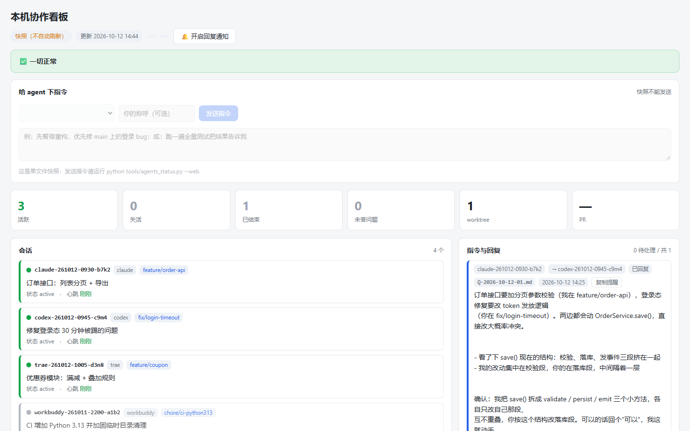

<h1>
  <picture>
    <source media="(prefers-color-scheme: dark)" srcset="site/assets/logo/logo.svg">
    
  </picture>
</h1>

[](https://www.python.org/)
[](#安装下载一次按项目复用)
[](#仓库结构与验证)
[](LICENSE)
[](CHANGELOG.md)

让同一台电脑上、同一项目里的多个 AI 助手遵循一份协作规则：开工先确认谁在做什么，
改动前避开冲突，收工留下能接手的记录。支持 Codex、Claude Code、OpenCode、Pi、Trae、
WorkBuddy、Cursor、GitHub Copilot、Windsurf、Gemini CLI、Qwen Code、Cline、Roo Code、Continue 和 Kiro，
**只安装当前项目需要的平台入口**。

[在线介绍与安装配置](https://aiflyf.github.io/multi-agent-collab/) ·
[交互演示](https://aiflyf.github.io/multi-agent-collab/demo.html) ·
[平台接入与验证](docs/PLATFORMS.md) · [更新记录](CHANGELOG.md)

[完整流程验证与能力边界](docs/VALIDATION.md) 记录实际覆盖的环节、发现的问题和后续优先项。



## 安装：下载一次，按项目复用

需要 **Python 3.8+、Git、一个已有的 Git 项目**。没有第三方 Python 依赖。
套件源码默认放在用户主目录 `~/multi-agent-collab`（Windows 为 `$HOME\multi-agent-collab`），
各个项目复用同一个安装器。源码与目标项目是两个目录，不要把套件 clone 到业务项目里。

下面的命令适用于 Bash 和 PowerShell：

```bash
# 只在第一次下载时运行；已经存在则核对来源后复用
git clone https://github.com/AiFLYF/multi-agent-collab "$HOME/multi-agent-collab"

# 在你的目标项目目录运行：例如当前使用 Codex 与 Claude Code
python "$HOME/multi-agent-collab/install.py" install . --platforms codex,claude
python "$HOME/multi-agent-collab/install.py" doctor .
```

- **自己在终端操作**：首次省略 `--platforms` 会询问，可输入编号或名称并用逗号多选。
- **交给 AI / 脚本执行**：明确传入 `--platforms`；未选择时会停止，不会默认全装。
- **原生平台**：只选 `codex`、`opencode` 或 `pi` 时共用 `AGENTS.md`，不生成其它平台目录，连 `CLAUDE.md` 也不安装。
- **预览文件**：安装命令加 `--dry-run`；只要通用规则可选 `--platforms none`，确实需要全部平台才用 `all`。
- **升级已有项目**：再次运行 `install .` 会沿用之前的选择，不再询问或偷偷增加平台。
- **适配项目分支流程**：默认 Git Flow；只有 main 的项目可明确使用 `--workflow github-flow`，也可配置基线和任务前缀。安装器不创建分支。

也可以从任意目录指定目标，例如：

```powershell
python "$HOME/multi-agent-collab/install.py" install "D:\code\my-app" --platforms codex
```

### 复制提示词给 AI

在**目标项目的对话**里粘贴下面这段。AI 先沿用已确认的平台和项目分支约定，缺少信息时才询问对应项。
[在线配置器](https://aiflyf.github.io/multi-agent-collab/#sec-6) 可以按勾选的平台生成同一份提示词。
使用 fork 时，将仓库地址换成你的 fork。

<!-- BEGIN INSTALL_PROMPT -->
```text
帮我把 multi-agent-collab 安装到当前项目，并验证所选平台的新对话入口。
套件仓库：https://github.com/AiFLYF/multi-agent-collab

1. 检查 Python 3.8+ 和 Git，确认当前项目的 Git 根目录并记下绝对路径 TARGET。缺依赖时说明，不自行安装软件或 git init。
2. 优先根据当前对话确认正在使用的平台并告诉我；无法确认时先问我使用哪些平台（可多选）：codex、claude、opencode、pi、trae、workbuddy、cursor、copilot、windsurf、gemini、qwen、cline、roo、continue、kiro。使用对应的 --platforms 名称；不要根据电脑里装过哪些软件就全部安装。
   读取项目现有分支约定与 .multi-agent-collab/policy.json；已有策略沿用，首次安装按已确认流程选择 git-flow、github-flow 或 custom。只有 main 的项目可使用 github-flow；无法确认时只询问分支流程，不擅自建立 develop 或改变远端结构。
3. 套件默认放在用户主目录的 multi-agent-collab：Windows 为 $HOME\multi-agent-collab，macOS/Linux 为 ~/multi-agent-collab。这里是可供多个项目复用的源码目录，不要 clone 到 TARGET 内。
   目录不存在时执行 git clone https://github.com/AiFLYF/multi-agent-collab "<用户主目录>/multi-agent-collab"。已存在时核对 origin 和 install.py 后复用；来源不符或有本地修改时保留现场并说明，不覆盖、不删除、不重置。只有确认工作区干净且配置了上游后，才用 git pull --ff-only 更新。
4. 使用绝对路径运行 python "<套件目录>/install.py" install "<TARGET>" --platforms <已选名称> --dry-run；首次安装附加已确认的 --workflow 参数，自定义流程还要 --base-branch 和 --task-prefixes。核对文件清单与分支策略后执行同一条命令去掉 --dry-run；不要默认 all。只选原生平台时不生成其它平台配置。
5. 新安装把套件规则、工具、记录放入 .multi-agent-collab/，默认在项目 .gitignore 的标记区忽略该目录；平台入口按精确路径写入 .git/info/exclude。已有 AGENTS.md 等共享入口保留原文，只维护小段标记。已跟踪入口的差异正常显示，不取消跟踪，不隐藏索引改动。来源不明的独立目录、损坏标记或被修改的套件文件先报告并保留现场。
6. 结合项目真实配置填写 .multi-agent-collab/RULES.md 第 6 节缺少的测试/构建命令，项目既有测试要求和已确认策略继续有效。保留已有规则、会话、日志和备份。旧版安装沿用 .agents/ 路径，不自动搬迁；新增平台使用 sync。
7. 执行 python "<套件目录>/install.py" doctor "<TARGET>"，并核对 git status --short；可用 clients "<TARGET>" --versions 检查 CLI 可用性，不启动模型。汇报套件复用路径、已选平台、项目分支策略、生成文件和体检结果；解释 WARN，版本查询不代表新对话已加载规则。
8. 告诉我新开对话验证：让 agent 读取 .multi-agent-collab/START_HERE.md，报告当前分支、看板和 inbox 的实际结果。之后增加平台用 sync "<TARGET>" --platforms <新增名称>，无需重复 clone；旧对话需要主动重新读取规则。

执行安装范围内可恢复的修复即可；遇到需要改变现有项目规则或 Git 跟踪状态的冲突，再说明具体情况让我决定。
```
<!-- END INSTALL_PROMPT -->

### 装完验证三件事

1. 保留原项目规则，在 `.multi-agent-collab/RULES.md` 第 6 节填写缺少的测试、构建命令。
   定制区升级会保留。核对 `.multi-agent-collab/POLICY.md` 与项目分支约定一致；安装器不会擅自创建分支。
2. 跑 `doctor .`，再在目标项目执行 `python .multi-agent-collab/tools/agents_status.py --brief`。检查 Git 忽略和入口是否完整。
3. **新开对话**，确认 agent 实际读取 `.multi-agent-collab/START_HERE.md`，并报告分支、看板与 inbox 当前结果。
   旧对话不会自动重新加载。只复述“我会先看板”不算验证通过。

## 安装后，项目里有什么

```text
你的项目/                         用户主目录/
├── AGENTS.md        项目原文 + 标记入口   └── multi-agent-collab/
├── .multi-agent-collab/                           └── install.py  所有项目复用
│   ├── RULES.md      协作总章
│   ├── START_HERE.md 新对话入口
│   ├── install.json 已选平台、版本、源码路径
│   ├── POLICY.md    当前分支策略（配置在 policy.json）
│   ├── sessions/    谁在什么分支做什么
│   ├── worklog/     最近完成了什么，下一步是什么
│   ├── inbox/       问题、交接、你的指令
│   └── …            格式说明、故障手册和模板
├── .multi-agent-collab/tools/agents_status.py        本地看板
├── .multi-agent-collab/tools/agents_session.py       登记、占用检查、心跳和收尾
├── .multi-agent-collab/tools/agents_policy.py        安装器与会话工具共用的策略校验
└── 所选平台入口                   见下表；没有选的不会创建
```

总章规定协调、分支、测试与交接；共享记录让会话彼此可见；平台入口引导 agent 在每个新对话
读取同一份文档。切分支不会丢掉本机记录，换电脑或重新 clone 则需要重新安装并自行迁移记录。

这是一套本机协作协议和工具。它可以和工作区编排工具配合使用；不会替你启动 AI、隔离文件系统、
锁住源码或同步到其它电脑。多个 agent 仍需遵守检查和登记约定。

## 协作不只靠提示词

新会话按启动清单协调并切到任务分支后，使用会话工具登记：

```bash
python .multi-agent-collab/tools/agents_session.py start --agent codex --task "完善登录" --files src/login.py tests/test_login.py --json
python .multi-agent-collab/tools/agents_session.py heartbeat <返回的会话ID> --agent codex --note "正在验证"
python .multi-agent-collab/tools/agents_session.py resume <会话ID> --agent codex --note "阻塞解除，继续原任务"
python .multi-agent-collab/tools/agents_session.py finish <会话ID> --agent codex --summary "完成登录修复" --tests "项目测试通过"
```

- 登记时检查同工作区、同分支和跨 worktree 的文件占用；目录声明能覆盖其子文件。
- 主 worktree 的系统锁让并发登记串行，避免两个 agent 同时通过检查；进程退出自动释放登记锁。
- 未确认的人类 inbox 会阻止新写任务；明确回执可用 `--ack-inbox` 纳入当前任务，实际完成前仍保留 open。
  工具检查会话所有者字段与实际分支，防止误操作。
- 失活仍保留占用，按接管流程协调；`handoff` 生成交接记录并保留 blocked 状态。
- `finish` 追加 worklog 并释放占用；看板显示文件范围、阶段进度与占用冲突。
- blocked 后用 `resume` 恢复自己的 ID；resume / finish 自动回执自己的交接条，避免长期残留未答告警。

扩大范围时先用 heartbeat 的 `--files` 更新完整列表。只读检查用 `check --files ... --json`。
这些检查协调遵守协议的 agent，不能锁住源码或阻止其它程序绕过登记。

只读咨询不用登记写会话，继续同一任务不用新建 ID。同文件不同函数仍算冲突，需要拆分或串行交接。
详细场景、失败处理与状态规则见 [协作操作手册](docs/WORKFLOW.md)。

### 自己验证一遍完整流程

```bash
python scripts/rehearse_workflow.py --report .multi-agent-collab/rehearsal-latest.md
```

脚本真实 clone 套件，在隔离项目中跑双项目复用、安装升级、worktree 协作、文件冲突、
网页指令与回复、中断恢复、收尾、业务测试、向本地 bare 远端推送和卸载预览，输出逐步报告并清理现场。
它不调用模型、不创建真实 GitHub PR；每个平台的新对话加载仍按平台说明单独验收。

## 平台选择与同步

<!-- BEGIN PLATFORM_TABLE -->
| `--platforms` 名称 | 平台 | 本套件安装的入口 |
|---|---|---|
| `codex` | Codex | 共用 `AGENTS.md`，无额外文件 |
| `claude` | Claude Code | `CLAUDE.md`<br>`.claude/commands/git-flow.md` |
| `opencode` | OpenCode | 共用 `AGENTS.md`，无额外文件 |
| `pi` | Pi | 共用 `AGENTS.md`，无额外文件 |
| `trae` | Trae | `.trae/rules/git-flow-agent.md` |
| `workbuddy` | WorkBuddy | `.workbuddy-ai/git-flow-agent.md` |
| `cursor` | Cursor | `.cursor/rules/multi-agent-collab.mdc` |
| `copilot` | GitHub Copilot | `.github/copilot-instructions.md` |
| `windsurf` | Windsurf | `.windsurf/rules/multi-agent-collab.md` |
| `gemini` | Gemini CLI | `GEMINI.md` |
| `qwen` | Qwen Code | `.qwen/QWEN.local.md` |
| `cline` | Cline | `.clinerules/multi-agent-collab.md` |
| `roo` | Roo Code | `.roo/rules/00-multi-agent-collab.md` |
| `continue` | Continue | `.continue/rules/multi-agent-collab.md` |
| `kiro` | Kiro | `.kiro/steering/multi-agent-collab.md` |
<!-- END PLATFORM_TABLE -->

Claude 通过 `CLAUDE.md` 导入共享规则；其斜杠命令需要手动调用。
Cursor / Trae 使用始终应用的项目规则，Windsurf 使用 `always_on` 规则；
Copilot 需要客户端启用项目自定义说明。WorkBuddy 使用简短协作入口，需在所用版本中验证入口加载。
详细的规则发现方式与限制见 [平台说明](docs/PLATFORMS.md)。

```bash
# 后来开始用 Cursor：追加入口，自动沿用原来的平台
python "$HOME/multi-agent-collab/install.py" sync . --platforms cursor

# 改过总章后刷新所有已选入口，含 WorkBuddy 入口
python "$HOME/multi-agent-collab/install.py" sync .

# 看可选平台和将生成的入口
python "$HOME/multi-agent-collab/install.py" platforms
```

`sync` 保留整个项目总章、已有启动文档和协作记录，只补齐或刷新平台入口及忽略规则。
`install` 用于升级核心模板，迁移项目定制区。两者的 `--platforms` 都是**追加**，不会删除已装入口；
`none` 不等于卸载。旧版安装会根据已有文件迁移平台选择，linked worktree 首装会继承主工作区的选择。
无需重复 clone，也没有后台下载或常驻同步进程。

## Git 忽略与已有文件

新安装默认把规则、工具和本机记录集中放进 **`.multi-agent-collab/`**，并在项目 **`.gitignore`** 追加一个有标记的忽略区。原有忽略规则完整保留。
新建的平台入口只在 `.git/info/exclude` 中按精确路径忽略，不隐藏整个 `.github/`、`.cursor/`、`tools/` 等项目目录。
套件源码自身也默认忽略 `.multi-agent-collab/`，但不要把源码仓库安装到自身。

`AGENTS.md` 保留项目原文，只追加类似入口：

```markdown
<!-- >>> multi-agent-collab:entry >>> -->
开始任务前读取 .multi-agent-collab/START_HERE.md 与 .multi-agent-collab/RULES.md，
结合本项目现有规则执行协作流程。
<!-- <<< multi-agent-collab:entry <<< -->
```

| 已有文件情况 | 默认处理 |
|---|---|
| 项目原有 AGENTS.md、CLAUDE.md、Gemini、Qwen、Copilot 说明 | 原文保留，只维护套件标记区，不额外隐藏原有入口 |
| 上述共享入口已经被 Git 跟踪 | 保持跟踪，入口改动正常显示；通过项目正常 PR 审查 |
| 已有未声明归属的平台专用入口或独立目录 | 停止并保留现场，不凭同名认定归属 |
| 标记损坏、非 UTF-8、路径类型冲突或链接路径 | 停止，不覆盖原文件 |
| 已安装的套件文件被修改 | 核对内容摘要；定制区内修改迁移，区外修改保留现场并报告 |
| 卸载 | 移除入口标记区；私有记录、策略、规则和备份保留，忽略继续生效 |

`install --dry-run` / `sync --dry-run` 展示计划与文本差异，不写盘。升级覆盖前按原始字节备份到 `.multi-agent-collab/backups/`。
项目既有测试要求、架构约定及已确认分支策略继续有效。协作规则不能笼统覆盖原项目规则。
忽略对已跟踪文件无效，安装器不取消跟踪，也不设置隐藏改动的索引标志。

**旧版兼容：** 已记录在 `.agents/install.json` 的安装保留原路径，工具仍能读取其记录；不自动搬迁未结束会话。
旧元数据没有内容摘要，升级遇到无法确认的文件差异会停下，请先核对 `--dry-run` 差异，勿直接覆盖。
源码开发仍使用 `tools/` 下的命令和本机 `.agents/` 记录；以下目标项目命令使用新版默认路径。

## 网页看板

在**目标项目目录**运行：

```bash
python .multi-agent-collab/tools/agents_status.py --web       # 本机网页指挥台
python .multi-agent-collab/tools/agents_status.py --brief     # agent 的一行开工检查
python .multi-agent-collab/tools/agents_status.py --html      # 单文件离线快照
```

看板每 5 秒刷新，显示会话、心跳、未答问题和 worktree 告警，也可以向 inbox 写指令。
agent 在任务阶段间隙读取和回复；空闲或已结束的会话需要你粘贴提醒再次唤起。
[交互演示](https://aiflyf.github.io/multi-agent-collab/demo.html) 使用示例数据，便于先体验操作，不连接真实项目。

<details>
<summary>局域网访问与其它输出</summary>

```bash
python .multi-agent-collab/tools/agents_status.py --json
python .multi-agent-collab/tools/agents_status.py --web --bind 0.0.0.0 --no-directives
```

默认只监听 `127.0.0.1`。局域网需要可写时，先设置 `MULTI_AGENT_BOARD_PASSWORD`；
不设置密码的对外可写服务会拒绝启动。HTTP 只适合可信网络，远程访问建议 SSH 端口转发。
可用 `MULTI_AGENT_BOARD_READONLY=1` 强制只读。

</details>

## 命令速查

下表的 `install.py` 位于复用的套件源码目录，`<项目>` 是目标工作区。

| 命令 | 用途 |
|---|---|
| `python install.py platforms [--json]` | 支持的平台和文件清单 |
| `python install.py install <项目> --platforms codex` | 首次按需安装；以后省略参数沿用 |
| `python install.py install <项目> --dry-run` | 安装预览，不写盘 |
| `python install.py sync <项目> [--platforms cursor]` | 刷新已选入口，或追加平台 |
| `python install.py doctor <项目>` | 核心文件、已选入口、版本、忽略及看板冒烟检查 |
| `python install.py clients <项目> [--versions] [--json]` | CLI 发现与版本检查；新对话加载仍需实际验证 |
| `python install.py install <项目> --workflow github-flow` | 明确使用 main 为 PR 基线；不建立或切换 Git 分支 |
| `python install.py mirror <项目>` | 旧命令兼容：追加 WorkBuddy 并同步已选入口 |
| `python install.py uninstall <项目>` | 移除忽略托管块，文件保留，此后会出现在 Git 状态中 |
| `python install.py uninstall <项目> --purge-files` | 再清理未修改的套件文件；定制、会话、日志、留言、策略、接管记录及备份保留 |

任何命令先用 `--help` 查看当前参数。手工复制容易漏掉平台选择记录和 Git worktree 的忽略位置，建议使用安装器。

### 项目策略与失联接管

`git-flow` 默认使用 develop；`github-flow` 默认使用 main；`custom` 明确基线和任务前缀。
升级和同步会沿用保存的策略，同一仓库各 worktree 以主工作区策略为准。
main、master、develop 和所选基线始终受保护。详见 [协作手册](docs/WORKFLOW.md#按项目选择分支策略)。

```text
python <套件目录>/install.py install <项目> --workflow custom --base-branch trunk --task-prefixes task/,fix/
python .multi-agent-collab/tools/agents_session.py takeover-inspect <原会话ID> --json
```

原会话失联时，先只读检查，再生成接管计划。声明至少等待 5 分钟、用户确认具体计划且快照一致后，
才收回协作占用；保留原会话、提交与未提交文件。完整命令见 [失联接管](docs/TAKEOVER.md)。

## 出问题时

先看目标项目的 `.multi-agent-collab/TROUBLESHOOTING.md`，再运行 `doctor`。
手册按协作、Git 引用、网络/终端分类；D 组用于追加自己的项目问题，升级保留。

- [会话填法](docs/examples/session-example.md)
- [同文件协作与交接示例](docs/examples/inbox-example.md)
- [项目故障记录示例](docs/examples/project-specific-troubleshooting.md)
- [平台没有加载规则时的检查顺序](docs/PLATFORMS.md#如何确认真的生效)

## 仓库结构与验证

```text
multi-agent-collab/
├── install.py                  # 安装 / 同步 / 体检 / 平台列表 / 卸载
├── docs/RULES.md  CLAUDE.md    # 发布到项目的规则与入口模板
├── tools/agents_status.py      # 零依赖协作看板
├── tools/agents_session.py     # 占用检查、原子登记、心跳、收尾与交接
├── tools/agents_policy.py      # 项目分支策略与校验
├── templates/                  # 会话 / 留言 / 日志 / 安装提示词
├── platforms/                  # 按需安装的平台入口模板
├── docs/                       # 启动流程、平台说明、共享格式与故障手册
├── scripts/sync_install_docs.py # 从安装器与提示词模板同步 README 和页面数据
├── scripts/rehearse_workflow.py # 隔离项目中的完整使用流程演练和报告
├── site/                       # 介绍页、安装配置器、交互演示（静态文件）
├── tests/selftest.py            # 44 个测试用例（15 单元 + 28 安装器 E2E）
├── tests/test_sessions.py       # 协作并发、占用、交接和新增平台回归
├── tests/test_policy_takeover.py # 策略继承、接管保护和客户端探测回归
└── .github/workflows/           # 3 系统 × 4 Python 版本 CI + Pages
```

```bash
python tools/agents_status.py --selfcheck
python tests/selftest.py
python -m unittest discover -s tests -p "test_*.py"
python scripts/rehearse_workflow.py --report .multi-agent-collab/rehearsal-latest.md
python scripts/sync_install_docs.py --check
```

测试在系统临时目录创建真实 Git 仓库，覆盖按平台安装、选择迁移、同步与幂等、忽略失败、
已跟踪文件保护、定制/备份、linked worktree、卸载和看板语义。
本地预览网站可在仓库执行 `python -m http.server 8080 --bind 127.0.0.1 --directory site`。

贡献时，根 `AGENTS.md` / `CLAUDE.md` / `platforms/` / 看板脚本是**已跟踪的产品源码**，
目标项目的本机私有约定不表示要从套件仓库删除这些模板。
运行记录 `.multi-agent-collab/` 仍留在本机，禁止在套件目录自安装。
改平台目录或安装提示词后运行 `python scripts/sync_install_docs.py`，并同步版本和 CHANGELOG。

## 起源与许可

协作规则来自 [ego-link-esp32](https://github.com/AiFLYF/ego-link-esp32) 多个 AI 会话中的事故与复盘，
抽离为适用于其它项目的本机套件。[MIT License](LICENSE)。
